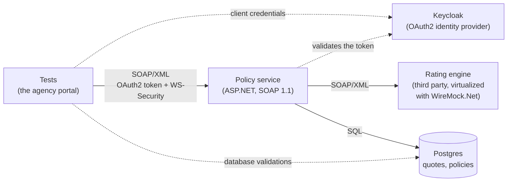
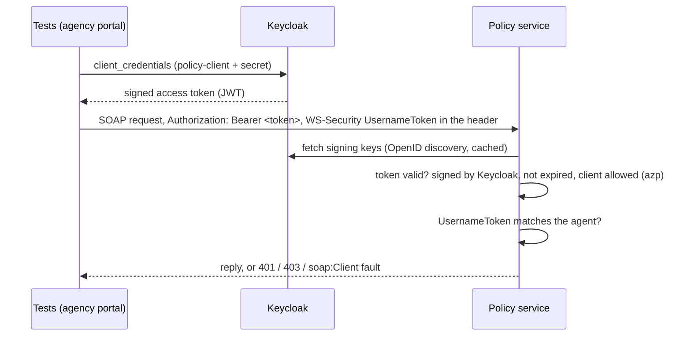

# DevtestLike

[](https://github.com/gillersja1/DevtestLike/actions/workflows/ci.yml)


**Enterprise test automation in the style of Broadcom DevTest**, built in C# with open tools: authentication,
XML-based orchestration and database validations across interconnected systems, with an unreliable
third-party dependency replaced by a **virtual service**.

DevTest (formerly CA LISA, now Broadcom Service Virtualization) is licensed enterprise software. This project
practices the same work on a realistic stack you can run with one command, and maps every piece to DevTest's
own terms in the [glossary](#devtest-glossary).

**Highlights**

- A legacy-style **SOAP 1.1 / XML** service, tested through **multi-step workflows**. Each step is built from values pulled out of the previous reply with **XPath**, and every reply is validated against an **XSD contract**.
- **Two layers of authentication**: an **OAuth2** token from a real **Keycloak**, plus a **WS-Security UsernameToken** inside the SOAP header.
- **Database validations** against a real **Postgres**, checking what was actually written, not just what the service said.
- **Service virtualization** with WireMock.Net: request matching by XPath, outages, timeouts, garbage replies and a stateful restart, on demand.
- **Data-driven tests** from a CSV data set.
- **Everything starts automatically** (Testcontainers). The only things to install are Docker and the .NET SDK. 30 tests run in seconds, on every push.

## Contents

- [The systems under test](#the-systems-under-test)
- [A workflow, end to end](#a-workflow-end-to-end)
- [What the tests cover](#what-the-tests-cover)
- [How authentication works](#how-authentication-works)
- [Run it](#run-it)
- [Project layout](#project-layout)
- [DevTest glossary](#devtest-glossary)
- [Design decisions](#design-decisions)
- [Roadmap](#roadmap)

## The systems under test

An insurance quoting flow, the kind of thing these platforms test in banks and insurers:



| System | What it is | In the tests |
|---|---|---|
| **Policy service** (`src/PolicyService`) | A SOAP 1.1 service with three operations. `GetQuote` calls the rating engine, applies the premium rules and saves the quote. `IssuePolicy` binds a quote into a policy in one database transaction. `GetPolicy` reads a policy back. Errors are SOAP faults: `soap:Client` for the caller's mistakes, `soap:Server` when a dependency fails. | Hosted in-process (`WebApplicationFactory`), wired to the other three |
| **Rating engine** | Someone else's SOAP service, which scores the risk and sets a base rate | A **virtual service** (WireMock.Net) |
| **Keycloak** | The identity provider. It has two clients: `policy-client`, which may call the service, and `reporting-client`, which may not. | Real, in Docker, with a realm imported from JSON |
| **Postgres** | The system of record (`quotes`, `policies`) | Real, in Docker, queried directly by the tests |

**Business rules** (what the tests verify):
- premium = base rate × (1 + risk score / 100), rounded to cents;
- a risk score of 80 or more is **declined**;
- a quote is valid for 30 minutes and can be bound only once.

## A workflow, end to end

The request the tests send. The OAuth2 token travels as an HTTP header (`Authorization: Bearer …`); the agent's credentials are inside the envelope:

```xml
<soap:Envelope xmlns:soap="http://schemas.xmlsoap.org/soap/envelope/">
  <soap:Header>
    <wsse:Security xmlns:wsse="http://docs.oasis-open.org/wss/2004/01/oasis-200401-wss-wssecurity-secext-1.0.xsd">
      <wsse:UsernameToken>
        <wsse:Username>agent-007</wsse:Username>
        <wsse:Password>…</wsse:Password>
      </wsse:UsernameToken>
    </wsse:Security>
  </soap:Header>
  <soap:Body>
    <GetQuote xmlns="http://devtestlike.example/policy">
      <applicant>
        <name>Ada Lovelace</name>
        <age>36</age>
        <vehicleValue>25000</vehicleValue>
        <state>OH</state>
      </applicant>
    </GetQuote>
  </soap:Body>
</soap:Envelope>
```

The reply. Risk 20 on a 500.00 base rate gives 500.00 × 1.20 = 600.00:

```xml
<soap:Envelope xmlns:soap="http://schemas.xmlsoap.org/soap/envelope/">
  <soap:Body>
    <GetQuoteResponse xmlns="http://devtestlike.example/policy">
      <quoteId>3f2c9a5e-8d1b-4c7e-9a40-6b2d1e0f7c13</quoteId>
      <status>offered</status>
      <riskScore>20</riskScore>
      <premium>600.00</premium>
      <expiresAt>2026-11-03T22:41:00Z</expiresAt>
    </GetQuoteResponse>
  </soap:Body>
</soap:Envelope>
```

And the test that chains three operations together, checking the contract and the database along the way
(from `QuoteToPolicyWorkflowTests`):

```csharp
// Step 1: quote.
var quote = (await agent.GetQuoteAsync(holder, age: 36)).ConformsToContract();
var quoteId = quote.Value("//p:quoteId");                        // XPath filter: save the id for later steps
Assert.That(quote.Value("//p:premium"), Is.EqualTo("600.00"));
Assert.That(await Db.QuoteAsync(quoteId), Is.EqualTo(new Db.QuoteRow("offered", 600.00m, 20, holder)));

// Step 2: bind it, using the id step 1 returned.
var issued = (await agent.IssuePolicyAsync(quoteId)).ConformsToContract();
var policyNumber = issued.Value("//p:policyNumber");
Assert.That((await Db.QuoteAsync(quoteId))!.Status, Is.EqualTo("bound"));       // both tables agree
Assert.That(await Db.PolicyAsync(policyNumber), Is.EqualTo(new Db.PolicyRow(quoteId, holder, 600.00m, "active")));

// Step 3: read it back by the number step 2 returned.
var read = (await agent.GetPolicyAsync(policyNumber)).ConformsToContract();
Assert.That(read.Value("//p:holderName"), Is.EqualTo(holder));
```

## What the tests cover

**30 tests in four suites.**

| Suite | Tests | What it checks |
|---|---|---|
| [`QuoteToPolicyWorkflowTests`](tests/DevtestLike.Tests/QuoteToPolicyWorkflowTests.cs) | 6 | **XML orchestration**: quote, bind and read back; a quote can only be bound once; declined quotes can't be bound; quotes expire (time is moved forward with a fake clock); unknown ids, malformed XML and unknown operations are faults. Every reply is checked against the XSD, and the database after each step. |
| [`AuthenticationTests`](tests/DevtestLike.Tests/AuthenticationTests.cs) | 8 | **Both layers**: no token (401), a forged token (401), a real token for the wrong application (403), a wrong client secret (Keycloak refuses to issue a token), a missing or wrong WS-Security UsernameToken (SOAP fault), and that a refused call writes nothing and never reaches the rating engine. |
| [`VirtualServiceTests`](tests/DevtestLike.Tests/VirtualServiceTests.cs) | 5 | **Service virtualization**: what goes over the wire to the rating engine, and what doesn't (the applicant's name stays private); an outage, a timeout and a garbage reply each become `soap:Server` faults with nothing saved; a stateful virtual service that's down once, then back. |
| [`DataDrivenQuoteTests`](tests/DevtestLike.Tests/DataDrivenQuoteTests.cs) | 11 | **A CSV data set** ([`applicants.csv`](tests/DevtestLike.Tests/DataSets/applicants.csv)): one test per row across the age bands, premiums and the decline rule, checked in the reply and the database. Invalid ages are rejected before the rating engine is called. Adding a scenario means adding a row. |

## How authentication works



- **Layer 1, the application:** ASP.NET's JWT bearer handler checks the token against Keycloak's published keys. An authorization policy then admits only the `policy-client` application, using the token's `azp` claim. A valid token for any other client gets **403**.
- **Layer 2, the person:** the SOAP header must carry the agent's WS-Security UsernameToken, as legacy services often require. Getting it wrong is a `soap:Client` fault.

## Run it

You need **Docker** (Docker Desktop on Windows or macOS) and the **.NET 10 SDK**.

```bash
git clone https://github.com/gillersja1/DevtestLike
cd DevtestLike
dotnet test
```

The first run downloads the Postgres and Keycloak images, which takes a minute or two. After that, a full run takes a few seconds plus container start-up.

Run one suite, or one test:

```bash
dotnet test --filter "FullyQualifiedName~AuthenticationTests"
dotnet test --filter "Name=QuoteThenBindThenReadBack"
```

The credentials in `devtestlike-realm.json` and `Enterprise.cs` are **test-only values** for throwaway containers.

## Project layout

```
contracts/policy.xsd                  the service's response contract (XSD)
src/PolicyService/
  Program.cs                          SOAP endpoint, both auth layers, the three operations
  Soap.cs                             envelopes and faults
  RatingClient.cs                     calls the rating engine; timeouts and bad replies become errors
  PolicyStore.cs                      Postgres: schema, quotes, the bind transaction
tests/DevtestLike.Tests/
  Environment/Enterprise.cs           starts Postgres + Keycloak + the virtual service, hosts the policy service
  Environment/RatingEngine.cs         the virtual service: XPath rules, faults, delays, stateful scenario
  Environment/PolicyCaller.cs         a SOAP client with OAuth2 + WS-Security; XPath and XSD helpers
  Environment/Db.cs                   database validation queries
  Environment/devtestlike-realm.json  Keycloak realm (clients and secrets for the tests)
  DataSets/applicants.csv             the data set
  *Tests.cs                           the four suites
```

## DevTest glossary

| DevTest | Here |
|---|---|
| Virtual service (VS), virtual service model (VSM) | The WireMock.Net rating engine ([`RatingEngine.cs`](tests/DevtestLike.Tests/Environment/RatingEngine.cs)) |
| Service image (VSI) and its transactions | The response rules in `WithStandardRules()`, matched on the request body by XPath |
| Stateful (conversational) transactions | `DownOnceThenUp()`, a WireMock scenario |
| Think time and response delays | `Slow(...)`, WireMock's `WithDelay` |
| Test case and its steps | A test method, such as `QuoteThenBindThenReadBack` (quote, bind, read back) |
| XML XPath filter (save a value into a property) | `reply.Value("//p:quoteId")`, which feeds the next step |
| Assertions (XML XPath, XML validation) | NUnit assertions on XPath values; `ConformsToContract()` validates against the XSD |
| JDBC step and result-set assertions | [`Db.cs`](tests/DevtestLike.Tests/Environment/Db.cs), which queries Postgres directly |
| Data set (CSV) | [`applicants.csv`](tests/DevtestLike.Tests/DataSets/applicants.csv) with NUnit's `TestCaseSource` |
| Config and test environment | [`Enterprise.cs`](tests/DevtestLike.Tests/Environment/Enterprise.cs), which starts and wires every system |
| Staging documents and test suites run in CI | GitHub Actions ([`ci.yml`](.github/workflows/ci.yml)); results also go to Grafana |

## Design decisions

- **Real dependencies where they matter, virtual where they don't.** Keycloak and Postgres are the real products in containers, so authentication and SQL behave exactly as in production. The rating engine is the system a team typically *can't* control (third-party, rate-limited, or unbuilt), so it's virtualized. That's the core argument for service virtualization.
- **The service is hosted in-process.** Tests can swap the clock (to expire quotes) or the timeout (to test slowness) per test, and still talk to it over real HTTP.
- **Every reply is checked against the contract, not only the fields a test reads**, so a renamed or missing element fails a test even if no assertion looks at it.
- **Database checks read the tables directly**, because "the service said OK" and "the right rows exist" are different claims. The bind is one transaction, and the tests check that a refused bind changes nothing.
- **The data set is a plain CSV**, so a business analyst could add a scenario without touching code.

## Roadmap

- **Message queue step**: the policy service publishes a "policy issued" event to ActiveMQ, and a test consumes it, like a DevTest JMS step.
- **SAML** sign-in through Keycloak, alongside OAuth2.
- **Record and playback**: proxy a live service through WireMock, record the traffic, and replay it as a virtual service, the way DevTest builds a VSI from recorded traffic.
- Test results on the [Grafana dashboard](https://github.com/gillersja1/test-results-otel), alongside the other projects in this portfolio.
